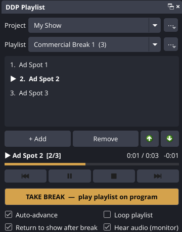

# DDP Playlist Player for OBS

A commercial and clip playlist player that lives inside OBS Studio as a dock.
Built by Drag Drop Production.

- **Projects** – one per show or client. Each keeps its own playlists.
- **Playlists** – e.g. "Commercial Break 1", "Sponsor Reel". Rename, duplicate, delete.
- **Clips** – drag video or audio files in, drag to reorder, rename the display name, remove.
- **Take Break** – one button cuts program to the *DDP Commercial Break* scene, plays the
  playlist top to bottom, then cuts back to the scene you were on.
- **Stream Deck / Companion** – every control is an OBS hotkey and an obs-websocket
  vendor request, with live state for button feedback. See [docs/COMPANION.md](docs/COMPANION.md).
- Saves automatically. Playlists survive OBS restarts and scene-collection switches.

Requires OBS Studio 30 or newer (Windows 10/11 64-bit, macOS 12+ Apple Silicon or Intel).

---

## Using it

1. Run the installer, then open OBS. The **DDP Playlist** panel appears on the right the first
   time. (Later: *Docks → DDP Playlist*.)
2. Pick or create a **Project** with the `⋯` button next to it.
3. Pick or create a **Playlist** with the `⋯` button next to it.
4. Drag commercials into the list (or click **+ Add**). Drag rows to set the order.
   Double-click a clip to rename it — the file on disk is never renamed.
5. Hit **TAKE BREAK**. Program cuts to the break scene and the clips play in order.
   When the last one ends, OBS goes back to your show scene on its own.
   Hit **END BREAK** any time to bail out early.

Prefer commercials over your own layout? Click **Add player to current scene** and use
the transport buttons (play/pause/stop/next/previous) instead of Take Break.

| Option | What it does |
|---|---|
| Auto-advance | Next clip starts when one ends (on by default) |
| Loop playlist | Starts over after the last clip |
| Return to show after break | Cuts back to the previous scene when the break finishes |
| Hear audio (monitor) | Sends the player's audio to your monitoring device as well as the stream |

Keyboard in the list: **Enter** plays, **F2** renames, **Delete** removes. Right-click a clip
for *Show file in folder*.

Missing files are shown in red and skipped during playback, so a moved file never stalls a break.

### Moving a project between computers

`⋯ → Export project…` writes a `.ddpplaylist` file; `Import project…` on the other machine
brings it in. Clips point at file paths, so keep the media in the same place (or re-add it).

### Where things are saved

| | Windows | macOS |
|---|---|---|
| Plugin | `C:\ProgramData\obs-studio\plugins\ddp-playlist` | `~/Library/Application Support/obs-studio/plugins/ddp-playlist.plugin` |
| Your playlists | `%APPDATA%\obs-studio\plugin_config\ddp-playlist\library.json` | `~/Library/Application Support/obs-studio/plugin_config/ddp-playlist/library.json` |

Uninstalling the plugin leaves your playlists in place.

---

## Building the installers (one-time setup)

The installers are built by GitHub for free — no compiler needed on your machine.

1. Create a new **private** GitHub repository (e.g. `ddp-playlist`) and upload everything
   in this folder to it (drag the files into *Add file → Upload files*, or use GitHub Desktop).
2. GitHub starts building automatically. Watch it under the **Actions** tab (about 15 min).
3. To make a release: on the repo page click **Releases → Draft a new release**, type a tag
   like `1.0.0`, and publish. (Or push a git tag `1.0.0`.) The build attaches:
   - `ddp-playlist-1.0.0-windows-x64-Installer.exe` – Windows installer
   - `ddp-playlist-1.0.0-macos-universal.pkg` – Mac installer
   - `.zip` / `.tar.xz` – manual-install archives
   The release is created as a **draft** so you can check it, then click *Publish*.
4. Upload those installer files to your website (or link straight to the GitHub release).
   A ready-made download section is in [`website/download.html`](website/download.html).

To ship an update: change `"version"` in `buildspec.json`, commit, and make a new release tag
that matches it.

### Code signing (optional, recommended later)

Without signing, people see a warning the first time:

- **Windows:** "Windows protected your PC" → *More info* → *Run anyway*.
- **Mac:** right-click the `.pkg` → *Open* → *Open*.

The Mac side signs and notarizes automatically once these repository secrets are added
(Apple Developer account, $99/yr): `MACOS_SIGNING_APPLICATION_IDENTITY`,
`MACOS_SIGNING_INSTALLER_IDENTITY`, `MACOS_SIGNING_CERT`, `MACOS_SIGNING_CERT_PASSWORD`,
`MACOS_KEYCHAIN_PASSWORD`, `MACOS_SIGNING_PROVISIONING_PROFILE`, `MACOS_NOTARIZATION_USERNAME`,
`MACOS_NOTARIZATION_PASSWORD`. Windows signing needs a code-signing certificate (e.g. Azure
Trusted Signing) added to `Package-Windows.ps1`.

### Building locally (developers)

Standard [obs-plugintemplate](https://github.com/obsproject/obs-plugintemplate) workflow:
`cmake --preset windows-x64` / `macos` / `ubuntu-x86_64`, then `cmake --build --preset <same>`.

## License

GPL-2.0-or-later, as required for OBS plugins. See [LICENSE](LICENSE).
